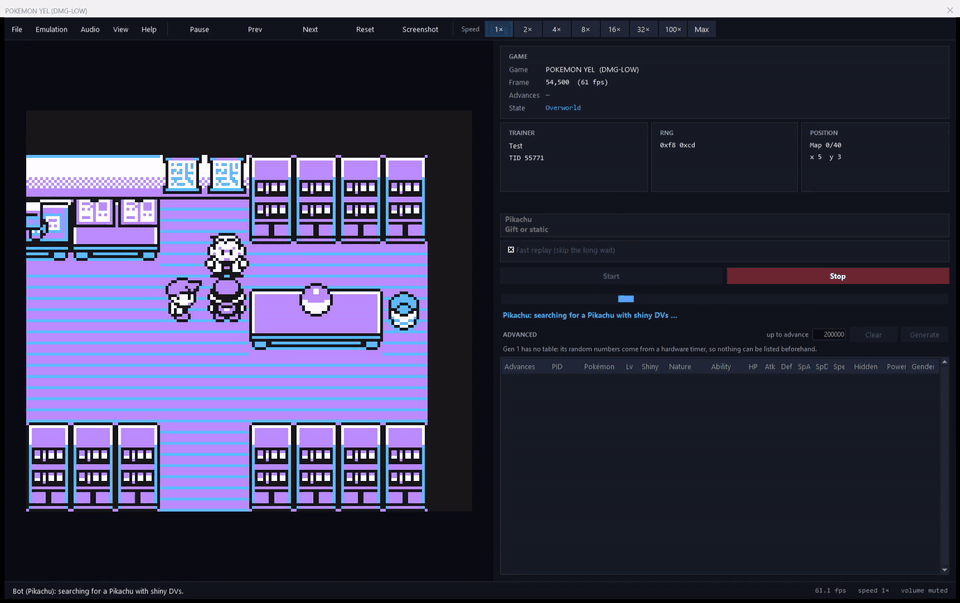
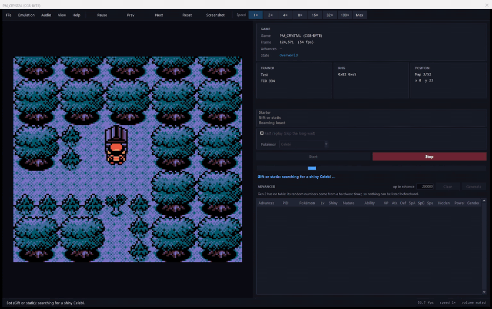
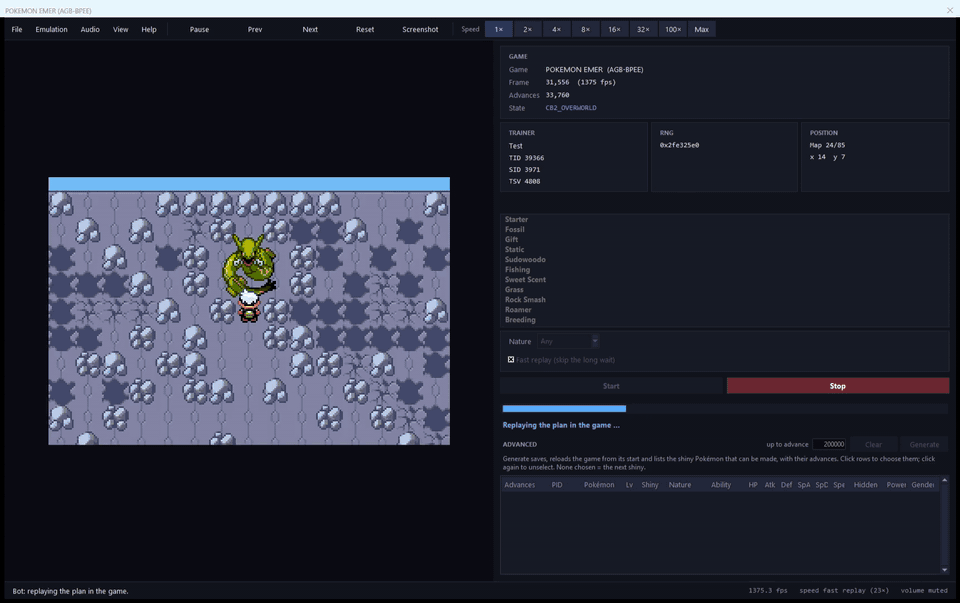

# Gen 1–3 Shiny Boy

A Windows shiny-hunting tool for the Game Boy, Game Boy Color and Game Boy Advance Pokémon games, built on the mGBA core. It reads the in-game Random Number Generator (RNG) state and uses precise input calibration to land a shiny Pokémon.

## Showcase

<table width="100%">
  <tr>
    <td align="center" width="33%"><b>Gen 1</b></td>
    <td align="center" width="33%"><b>Gen 2</b></td>
    <td align="center" width="33%"><b>Gen 3</b></td>
  </tr>
  <tr>
    <td></td>
    <td></td>
    <td></td>
  </tr>
</table>

## Supported games

English versions, original release (revision 0) only.

| Short name | Games                   |
| ---------- | ----------------------- |
| RBY        | Red, Blue, Yellow       |
| GSC        | Gold, Silver, Crystal   |
| RSE        | Ruby, Sapphire, Emerald |
| FRLG       | FireRed, LeafGreen      |

## Bots

**Note:** Gen 1 has no shiny Pokémon. The bots find shiny DVs, which only show as shiny once the Pokémon is moved beyond Gen 1.

<table width="100%">
<tr>
<td valign="top" width="44%">

**Gen 1 (RBY)**

| Bot           | RB  |      Y       |
| ------------- | :-: | :----------: |
| Starter       | ✅  | ✅ (Pikachu) |
| Gift / Static | ✅  |      ✅      |

**Gen 2 (GSC)**

| Bot                                       | GS  |  C  |
| ----------------------------------------- | :-: | :-: |
| Starter                                   | ✅  | ✅  |
| Gift / Static | ✅  | ✅  |
| Roaming beast                             | ✅  | ✅  |

</td>
<td valign="top" width="56%">

**Gen 3 (RSE, FRLG)**

| Bot                                   | RS  |  E  | FRLG |
| ------------------------------------- | :-: | :-: | :--: |
| Starter                               | ✅  | ✅  |  ✅  |
| Gift / Static                         | ✅  | ✅  |  ✅  |
| Fossil                                | ✅  | ✅  |  ✅  |
| Fishing                               | ✅  | ✅  |  ✅  |
| Sweet Scent                           | ✅  | ✅  |  ✅  |
| Grass / Caves / Surfing / Safari Zone | ✅  | ✅  |  ✅  |
| Roamer                                | ✅  | ✅  |  ✅  |
| Breeding                              | ✅  | ✅  |  ✅  |

</td>
</tr>
</table>

## Credits

- Built on [mGBA](https://github.com/mgba-emu/mgba), a Game Boy Advance emulator.
